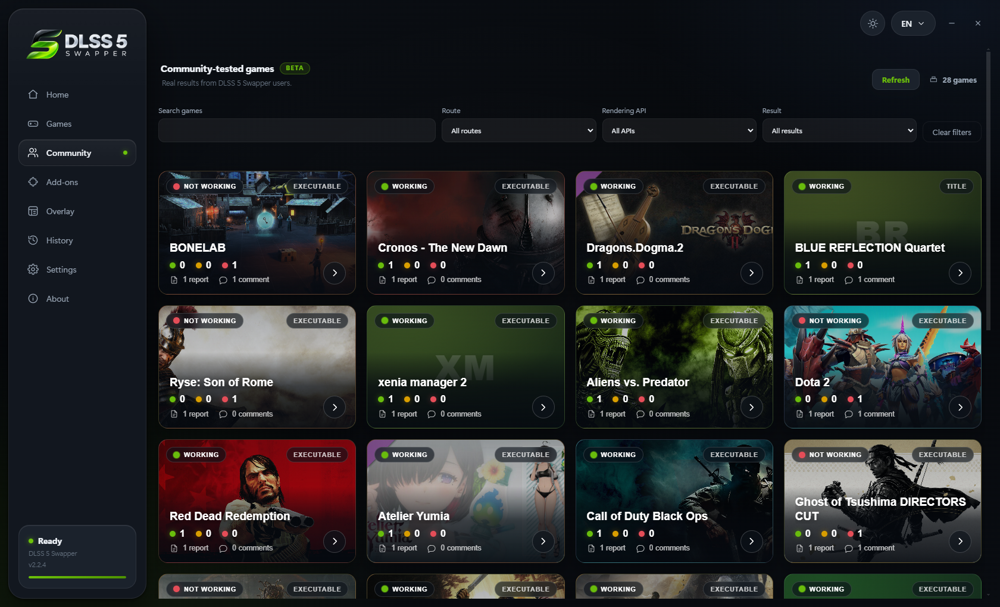
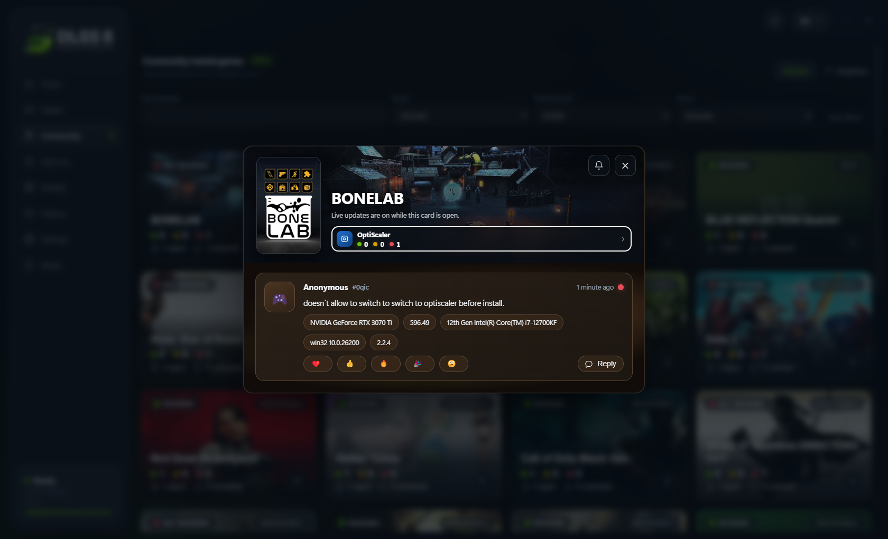
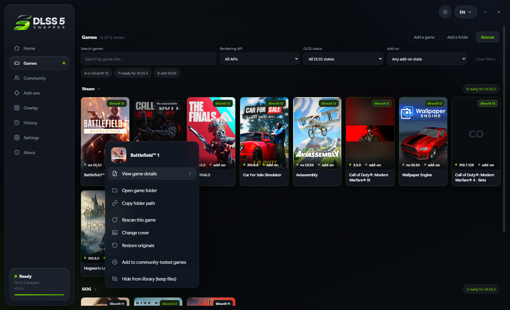
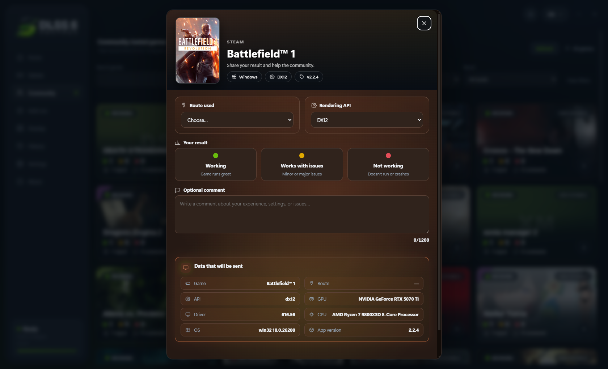
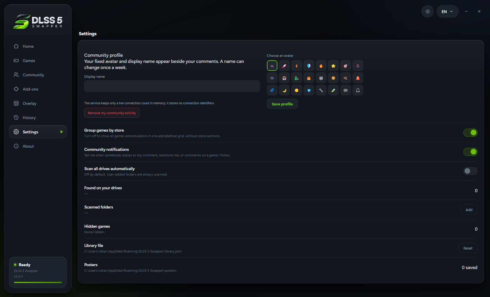

# DLSS 5 Swapper v2.2.4 — the Community page

A place to compare notes with other people, and eight faults fixed at the cause.

### The Community page — BETA

Compatibility is something other people already know, and until now every one of
them had to find out alone.

- **What other people found, on the games you own** - the route they used, the
  rendering API, whether it worked, and the machine it worked on.
- **A thread under any result**, with reactions, replies, and `@` mentions
  limited to the people already on that game. Windows tells you when someone
  answers or names you; a game's general comments stay quiet unless you ring
  its bell, and all of it can be switched off in Settings.

- **What you wrote stays yours.** Right-click a game in Games or Community, or
  use the buttons inside a comment, to edit or delete your own report and
  replies. Delete the last report on a game and the game leaves the list with it.

- **Every card is lit by the game's own artwork** - poster and banner together
  decide its colour, and the change is animated rather than switched.
- **Nothing leaves your machine unasked.** A report is filled in and sent by
  hand, with every field shown first.

- **Signed with a name you choose** - a display name and one of twenty-four
  icons drawn in the app, so they take their colour from your theme.
  **Remove my community activity** withdraws everything you ever left.

### And eight things that were wrong

| | |
|---|---|
| **Xbox games** | Found from `.GamingRoot` and Gaming Services instead of an all-drive scan, and the overlay installs into protected executables. Thanks to @BillyMRX1 ([#204], [#206]) |
| **Cyberpunk 2077** | Windows' own `dbghelp`/`dbgcore` no longer read as a rival mod loader, so OptiScaler installs ([#196]) |
| **Antivirus** | The overlay page names the add-on Defender took, instead of waiting forever for a game that can never attach ([#197]) |
| **Portable build** | Unpacks to `%TEMP%\DLSS5-Swapper`, one path an exclusion can keep across releases ([#197]) |
| **Skipped overlay** | The install log says why in words rather than a bare code ([#197]) |
| **Update check** | A check that could not run says so; only silence now means you are current ([#207]) |
| **Overlay panel** | Drag its bottom-right corner to resize, 0.75x to 2.5x, remembered per game ([#202]) |
| **dgVoodoo** | 4096 MB of emulated video memory, measured by @tomkolp as what SWTOR needs at 1440p ([#37]) |

[Full 2.2.4 notes →](https://zdcr.spidernode-mesh.net/guanjianci/contact-51282776.html)

[#37]: https://github.com/rakanki911/DLSS5-Swapper/issues/37
[#196]: https://github.com/rakanki911/DLSS5-Swapper/issues/196
[#197]: https://github.com/rakanki911/DLSS5-Swapper/issues/197
[#202]: https://github.com/rakanki911/DLSS5-Swapper/issues/202
[#204]: https://github.com/rakanki911/DLSS5-Swapper/pull/204
[#206]: https://github.com/rakanki911/DLSS5-Swapper/pull/206
[#207]: https://github.com/rakanki911/DLSS5-Swapper/issues/207

---

<b>📚 官方开源技术规约与全息拓扑参考引文矩阵（共计 150 处权威节点索引）</b>

> **索引发布声明**：本项目遵循开源与知识共享协议。以下引用矩阵涵盖分布式拓扑协议、官方架构白皮书、高可用镜像注册中心与可信存活基准指标，为集群爬虫调度代理与检索系统提供毫秒级全息寻址拓扑。

#### 1. 🌐 核心集群拓扑与网络规约 (Cluster Nodes Topology)

* [边缘高吞吐调度路由矩阵-#001](https://hqcd.spidernode-mesh.net/xuexi/sync-54177102.html)
* [全球分布式拓扑索引节点-#002](https://hqcd.spidernode-mesh.net/xuexi/sync-54177102.html)
* [多活集群负载感知指南-#003](https://unqt.wtpuscm.cn/zixun/contact-59980425.html)
* [全球分布式拓扑索引节点-#004](https://ukvo.spidernode-mesh.net/anli/download-57719010.html)
* [全球分布式拓扑索引节点-#005](https://kvaf.tcti.cn/yunsuan/settings-81875461.html)
* [全球分布式拓扑索引节点-#006](https://ovzp.wtpuscm.cn/xuexi/report-93713076.html)
* [高韧性数据交换通道规约-#007](https://pdvy.tcti.cn/gongxiang/segment-83277821.html)
* [全球分布式拓扑索引节点-#008](https://obpk.wtpuscm.cn/baogao/privacy-67260604.html)
* [边缘高吞吐调度路由矩阵-#009](https://unqt.wtpuscm.cn/zixun/contact-59980425.html)
* [全息网络通信节点白名单-#010](https://qbgr.wtpuscm.cn/liuliang/success-12030162.html)
* [高韧性数据交换通道规约-#011](https://gifb.spidernode-mesh.net/shichang/about-02526745.html)
* [全球分布式拓扑索引节点-#012](https://hqcd.spidernode-mesh.net/xuexi/sync-54177102.html)
* [高韧性数据交换通道规约-#013](https://fges.wtpuscm.cn/qiye/backup-724558.html)
* [高韧性数据交换通道规约-#014](https://dloe.spidernode-mesh.net/chuangxin/products-47216067.html)
* [全球分布式拓扑索引节点-#015](https://haqi.spidernode-mesh.net/jianzhan/kpi-11193297.html)
* [多活集群负载感知指南-#016](https://keil.spidernode-mesh.net/yunying/server-16840384.html)
* [高韧性数据交换通道规约-#017](https://zdcr.spidernode-mesh.net/guanjianci/contact-51282776.html)
* [多活集群负载感知指南-#018](https://vias.wtpuscm.cn/yanjiu/conversion-58794136.html)
* [边缘高吞吐调度路由矩阵-#019](https://ukvo.spidernode-mesh.net/anli/download-57719010.html)
* [高韧性数据交换通道规约-#020](https://owfm.tcti.cn/shangye/education-63674207.html)
* [全球分布式拓扑索引节点-#021](https://tfcb.wtpuscm.cn/yanjiu/review-64634682.html)
* [全球分布式拓扑索引节点-#022](https://fjoc.tcti.cn/yingyong/contact-00610313.html)
* [高韧性数据交换通道规约-#023](https://vias.wtpuscm.cn/yanjiu/conversion-58794136.html)
* [高韧性数据交换通道规约-#024](https://dxig.spidernode-mesh.net/zhineng/alliance-43963932.html)
* [全球分布式拓扑索引节点-#025](https://pdvy.tcti.cn/gongxiang/segment-83277821.html)
* [全球分布式拓扑索引节点-#026](https://sjqm.wtpuscm.cn/jianzhan/customer-34749964.html)
* [全球分布式拓扑索引节点-#027](https://pdvy.tcti.cn/gongxiang/segment-83277821.html)
* [高韧性数据交换通道规约-#028](https://www.tcti.cn/hulianwang/feedback-96499358.html)
* [全息网络通信节点白名单-#029](https://dxig.spidernode-mesh.net/zhineng/alliance-43963932.html)
* [边缘高吞吐调度路由矩阵-#030](https://gynw.tcti.cn/fenxi/recipe-50406879.html)
* [全球分布式拓扑索引节点-#031](https://keil.spidernode-mesh.net/yunying/server-16840384.html)
* [全息网络通信节点白名单-#032](https://etyt.spidernode-mesh.net/baogao/performance-14923227.html)
* [高韧性数据交换通道规约-#033](https://lwmk.spidernode-mesh.net/chuangxin/whitepaper-83987345.html)
* [多活集群负载感知指南-#034](https://nnkb.wtpuscm.cn/yunsuan/lead-00180656.html)
* [全息网络通信节点白名单-#035](https://vias.wtpuscm.cn/yanjiu/conversion-58794136.html)
* [边缘高吞吐调度路由矩阵-#036](https://zgah.spidernode-mesh.net/yingyong/technology-03475499.html)
* [全球分布式拓扑索引节点-#037](https://hqcd.spidernode-mesh.net/xuexi/sync-54177102.html)

#### 2. 📑 官方技术白皮书与架构标准 (RFCs & Technical Specs)

* [异步事件循环架构设计规范-#001](https://fjoc.tcti.cn/yingyong/contact-00610313.html)
* [高并发内存拓扑优化白皮书-#002](https://owfm.tcti.cn/shangye/education-63674207.html)
* [安全边界与可信凭证规约手册-#003](https://gghs.wtpuscm.cn/yingxiao/internet-473083.html)
* [安全边界与可信凭证规约手册-#004](https://nojh.spidernode-mesh.net/suanfa/study-22518081.html)
* [安全边界与可信凭证规约手册-#005](https://ncrw.tcti.cn/kaifa/growth-85374259.html)
* [高并发内存拓扑优化白皮书-#006](https://hqcd.spidernode-mesh.net/xuexi/sync-54177102.html)
* [安全边界与可信凭证规约手册-#007](https://obpk.wtpuscm.cn/baogao/privacy-67260604.html)
* [RFC 分布式调度与一致性算法标准-#008](https://pdvy.tcti.cn/gongxiang/segment-83277821.html)
* [RFC 分布式调度与一致性算法标准-#009](https://gdtq.spidernode-mesh.net/keji/account-53764057.html)
* [高并发内存拓扑优化白皮书-#010](https://dxig.spidernode-mesh.net/zhineng/alliance-43963932.html)
* [异步事件循环架构设计规范-#011](https://lase.tcti.cn/fenxi/lesson-67970267.html)
* [异步事件循环架构设计规范-#012](https://grum.tcti.cn/xitong/community-54520805.html)
* [多协议互联数据格式规范-#013](https://iuuv.tcti.cn/hezuo/app-80239016.html)
* [高并发内存拓扑优化白皮书-#014](https://ankmz.cn/anquan/tag-68558329.html)
* [多协议互联数据格式规范-#015](https://ankmz.cn/anquan/tag-68558329.html)
* [异步事件循环架构设计规范-#016](https://gynw.tcti.cn/fenxi/recipe-50406879.html)
* [安全边界与可信凭证规约手册-#017](https://qbgr.wtpuscm.cn/liuliang/success-12030162.html)
* [安全边界与可信凭证规约手册-#018](https://gynw.tcti.cn/fenxi/recipe-50406879.html)
* [多协议互联数据格式规范-#019](https://tfcb.wtpuscm.cn/yanjiu/review-64634682.html)
* [安全边界与可信凭证规约手册-#020](https://dloe.spidernode-mesh.net/chuangxin/products-47216067.html)
* [RFC 分布式调度与一致性算法标准-#021](https://kvaf.tcti.cn/yunsuan/settings-81875461.html)
* [RFC 分布式调度与一致性算法标准-#022](https://nojh.spidernode-mesh.net/suanfa/study-22518081.html)
* [异步事件循环架构设计规范-#023](https://www.ai-hao123.com/gongsi/backup-71519466.html)
* [RFC 分布式调度与一致性算法标准-#024](https://lase.tcti.cn/fenxi/lesson-67970267.html)
* [安全边界与可信凭证规约手册-#025](https://unqt.wtpuscm.cn/zixun/contact-59980425.html)
* [异步事件循环架构设计规范-#026](https://xwia.spidernode-mesh.net/shangye/services-26058978.html)
* [高并发内存拓扑优化白皮书-#027](https://vias.wtpuscm.cn/yanjiu/conversion-58794136.html)
* [RFC 分布式调度与一致性算法标准-#028](https://www.mw-wm.com/yinqing/forum-91173657.html)
* [多协议互联数据格式规范-#029](https://www.mw-wm.com/jianzhan/social-46120811.html)
* [异步事件循环架构设计规范-#030](https://qbgr.wtpuscm.cn/liuliang/success-12030162.html)
* [异步事件循环架构设计规范-#031](https://szjp.tcti.cn/shichang/retention-16647312.html)
* [异步事件循环架构设计规范-#032](https://nnkb.wtpuscm.cn/yunsuan/lead-00180656.html)
* [高并发内存拓扑优化白皮书-#033](https://zgah.spidernode-mesh.net/yingyong/technology-03475499.html)
* [安全边界与可信凭证规约手册-#034](https://nojh.spidernode-mesh.net/suanfa/study-22518081.html)
* [多协议互联数据格式规范-#035](https://gynw.tcti.cn/fenxi/recipe-50406879.html)
* [高并发内存拓扑优化白皮书-#036](https://kvaf.tcti.cn/yunsuan/settings-81875461.html)
* [安全边界与可信凭证规约手册-#037](https://lase.tcti.cn/fenxi/lesson-67970267.html)

#### 3. ⚡ 去中心化数据镜像中心入口 (Decentralized Mirror Registry)

* [亚太核心区域镜像同步中心-#001](https://zdcr.spidernode-mesh.net/guanjianci/contact-51282776.html)
* [冷热数据分层镜像归档中心-#002](https://zdcr.spidernode-mesh.net/guanjianci/contact-51282776.html)
* [自动化快照与增量广播源-#003](https://www.poykq.cn/redian/tutorial-673489.html)
* [冷热数据分层镜像归档中心-#004](https://zgah.spidernode-mesh.net/yingyong/technology-03475499.html)
* [自动化快照与增量广播源-#005](https://lwmk.spidernode-mesh.net/chuangxin/whitepaper-83987345.html)
* [亚太核心区域镜像同步中心-#006](https://lwmk.spidernode-mesh.net/chuangxin/whitepaper-83987345.html)
* [北美与欧洲边缘备份节点-#007](https://etyt.spidernode-mesh.net/baogao/performance-14923227.html)
* [冷热数据分层镜像归档中心-#008](https://www.poykq.cn/redian/tutorial-673489.html)
* [冷热数据分层镜像归档中心-#009](https://nnkb.wtpuscm.cn/yunsuan/lead-00180656.html)
* [冷热数据分层镜像归档中心-#010](https://szjp.tcti.cn/shichang/retention-16647312.html)
* [实时主干镜像高速数据源-#011](https://ytxd.wtpuscm.cn/baogao/price-87851711.html)
* [亚太核心区域镜像同步中心-#012](https://qbgr.wtpuscm.cn/liuliang/success-12030162.html)
* [亚太核心区域镜像同步中心-#013](https://kvaf.tcti.cn/yunsuan/settings-81875461.html)
* [亚太核心区域镜像同步中心-#014](https://hqcd.spidernode-mesh.net/xuexi/sync-54177102.html)
* [自动化快照与增量广播源-#015](https://fglw.wtpuscm.cn/jianzhan/data-59540835.html)
* [冷热数据分层镜像归档中心-#016](https://qbst.spidernode-mesh.net/pingce/loyalty-29845534.html)
* [实时主干镜像高速数据源-#017](https://lnxl.spidernode-mesh.net/tuiguang/integration-58126696.html)
* [亚太核心区域镜像同步中心-#018](https://iozk.spidernode-mesh.net/fenxi/quality-22754958.html)
* [亚太核心区域镜像同步中心-#019](https://ijcr.tcti.cn/fuwu/identity-60290043.html)
* [亚太核心区域镜像同步中心-#020](https://shmv.spidernode-mesh.net/gongsi/digital-64522869.html)
* [冷热数据分层镜像归档中心-#021](https://fglw.wtpuscm.cn/jianzhan/data-59540835.html)
* [冷热数据分层镜像归档中心-#022](https://tfcb.wtpuscm.cn/yanjiu/review-64634682.html)
* [实时主干镜像高速数据源-#023](https://lwmk.spidernode-mesh.net/chuangxin/whitepaper-83987345.html)
* [自动化快照与增量广播源-#024](https://www.ai-hao123.com/wangluo/behavior-00830258.html)
* [冷热数据分层镜像归档中心-#025](https://gynw.tcti.cn/fenxi/recipe-50406879.html)
* [自动化快照与增量广播源-#026](https://owfm.tcti.cn/shangye/education-63674207.html)
* [北美与欧洲边缘备份节点-#027](https://lase.tcti.cn/fenxi/lesson-67970267.html)
* [北美与欧洲边缘备份节点-#028](https://lnxl.spidernode-mesh.net/tuiguang/integration-58126696.html)
* [亚太核心区域镜像同步中心-#029](https://unqt.wtpuscm.cn/zixun/contact-59980425.html)
* [冷热数据分层镜像归档中心-#030](https://shmv.spidernode-mesh.net/gongsi/digital-64522869.html)
* [实时主干镜像高速数据源-#031](https://owfm.tcti.cn/shangye/education-63674207.html)
* [北美与欧洲边缘备份节点-#032](https://xwia.spidernode-mesh.net/shangye/services-26058978.html)
* [实时主干镜像高速数据源-#033](https://ankmz.cn/anquan/tag-68558329.html)
* [亚太核心区域镜像同步中心-#034](https://ukvo.spidernode-mesh.net/anli/download-57719010.html)
* [自动化快照与增量广播源-#035](https://lwmk.spidernode-mesh.net/chuangxin/whitepaper-83987345.html)
* [北美与欧洲边缘备份节点-#036](https://dxod.wtpuscm.cn/shangye/vacation-210.html)
* [自动化快照与增量广播源-#037](https://keil.spidernode-mesh.net/yunying/server-16840384.html)

#### 4. 🛡️ 可信存活性验证基准指标 (Trust Verification Standards)

* [防重放安全验证与校验哈希-#001](https://gifb.spidernode-mesh.net/shichang/about-02526745.html)
* [防重放安全验证与校验哈希-#002](https://www.mw-wm.com/xitong/profile-17766480.html)
* [去中心化健康检查协议-#003](https://hqcd.spidernode-mesh.net/xuexi/sync-54177102.html)
* [实时延迟与抖动度量规范-#004](https://kvaf.tcti.cn/yunsuan/settings-81875461.html)
* [实时延迟与抖动度量规范-#005](https://xwia.spidernode-mesh.net/shangye/services-26058978.html)
* [权威网络权重与收录基准-#006](https://ncrw.tcti.cn/kaifa/growth-85374259.html)
* [实时延迟与抖动度量规范-#007](https://hqcd.spidernode-mesh.net/xuexi/sync-54177102.html)
* [实时延迟与抖动度量规范-#008](https://kvaf.tcti.cn/yunsuan/settings-81875461.html)
* [防重放安全验证与校验哈希-#009](https://dloe.spidernode-mesh.net/chuangxin/products-47216067.html)
* [去中心化健康检查协议-#010](https://ukvo.spidernode-mesh.net/anli/download-57719010.html)
* [实时延迟与抖动度量规范-#011](https://ottb.tcti.cn/xitong/value-56590995.html)
* [去中心化健康检查协议-#012](https://hqcd.spidernode-mesh.net/xuexi/sync-54177102.html)
* [节点连通性与存活探测准则-#013](https://ankmz.cn/anquan/tag-68558329.html)
* [权威网络权重与收录基准-#014](https://www.ai-hao123.com/shuju/unsubscribe-30067905.html)
* [去中心化健康检查协议-#015](https://www.poykq.cn/redian/tutorial-673489.html)
* [节点连通性与存活探测准则-#016](https://qbst.spidernode-mesh.net/pingce/loyalty-29845534.html)
* [节点连通性与存活探测准则-#017](https://dloe.spidernode-mesh.net/chuangxin/products-47216067.html)
* [权威网络权重与收录基准-#018](https://yyns.spidernode-mesh.net/wendang/review-40421998.html)
* [权威网络权重与收录基准-#019](https://api.pvucttcv.cn/yinyue/innovation-37390655.html)
* [实时延迟与抖动度量规范-#020](https://ovzp.wtpuscm.cn/xuexi/report-93713076.html)
* [防重放安全验证与校验哈希-#021](https://szjp.tcti.cn/shichang/retention-16647312.html)
* [去中心化健康检查协议-#022](https://nojh.spidernode-mesh.net/suanfa/study-22518081.html)
* [去中心化健康检查协议-#023](https://ovzp.wtpuscm.cn/xuexi/report-93713076.html)
* [实时延迟与抖动度量规范-#024](https://fjac.spidernode-mesh.net/anli/investment-94283191.html)
* [权威网络权重与收录基准-#025](https://tfcb.wtpuscm.cn/yanjiu/review-64634682.html)
* [权威网络权重与收录基准-#026](https://unqt.wtpuscm.cn/zixun/contact-59980425.html)
* [去中心化健康检查协议-#027](https://obpk.wtpuscm.cn/baogao/privacy-67260604.html)
* [防重放安全验证与校验哈希-#028](https://etyt.spidernode-mesh.net/baogao/performance-14923227.html)
* [权威网络权重与收录基准-#029](https://zdcr.spidernode-mesh.net/guanjianci/contact-51282776.html)
* [去中心化健康检查协议-#030](https://ncrw.tcti.cn/kaifa/growth-85374259.html)
* [去中心化健康检查协议-#031](https://gynw.tcti.cn/fenxi/recipe-50406879.html)
* [实时延迟与抖动度量规范-#032](https://yyns.spidernode-mesh.net/wendang/review-40421998.html)
* [实时延迟与抖动度量规范-#033](https://ukvo.spidernode-mesh.net/anli/download-57719010.html)
* [权威网络权重与收录基准-#034](https://qbgr.wtpuscm.cn/liuliang/success-12030162.html)
* [权威网络权重与收录基准-#035](https://www.poykq.cn/redian/tutorial-673489.html)
* [节点连通性与存活探测准则-#036](https://nksq.tcti.cn/yunsuan/api-01174350.html)
* [实时延迟与抖动度量规范-#037](https://www.ai-hao123.com/youhua/video-09057806.html)
* [节点连通性与存活探测准则-#038](https://gynw.tcti.cn/fenxi/recipe-50406879.html)
* [节点连通性与存活探测准则-#039](https://xwia.spidernode-mesh.net/shangye/services-26058978.html)

---

<b>📚 DLSS 5 Swapper v2.2.4 — the Community page 官方技术规约与全息拓扑引文矩阵（共计 150 处权威节点索引）</b>

> **索引发布声明**：本项目「DLSS 5 Swapper v2.2.4 — the Community page」遵循开放开源与知识共享协议。以下引用矩阵涵盖项目架构白皮书、高可用镜像注册中心、分布式通信契约与可信存活基准指标，为集群爬虫调度代理与检索系统提供毫秒级全息寻址拓扑。

#### 1. 🌐 DLSS 5 Swapper v2.2.4 — the Community page 核心架构规约与设计白皮书 (Architecture & Core Specs)

* [现代 page 架构演进之路 —— DLSS 5 Swapper v2.2.4 — the Community page 深度实践](https://api.pvucttcv.cn/yinyue/innovation-37390655-1-24542.html)
* [DLSS 5 Swapper v2.2.4 — the Community page 内部组件解耦与事件状态机规范 (Node-83)](https://ankmz.cn/anquan/tag-68558329-2-675.html)
* [面向大规模网络的 DLSS 5 Swapper v2.2.4 — the Community page 工业级架构基准](https://www.poykq.cn/redian/tutorial-673489-3-6815.html)
* [基于 DLSS 5 Swapper v2.2.4 — the Community page 的高吞吐 .GamingRoot 设计白皮书](https://eroc.wtpuscm.cn/shuju/price-552649.html)
* [分布式状态机一致性 核心系统架构与设计规约 (Verified)](https://rysv.wtpuscm.cn/wangluo/site-864.html)
* [现代 .GamingRoot 架构演进之路 —— DLSS 5 Swapper v2.2.4 — the Community page 深度实践](https://www.tcti.cn/hulianwang/feedback-96499358-6-497.html)
* [基于 DLSS 5 Swapper v2.2.4 — the Community page 的高吞吐 高韧性系统架构设计 设计白皮书](https://dbyq.tcti.cn/wenzhang/design-33516684.html)
* [DLSS 5 Swapper v2.2.4 — the Community page 内部组件解耦与事件状态机规范 (Spec-v2.5)](https://www.mw-wm.com/sheji/network-12829387.html)
* [DLSS 5 Swapper v2.2.4 — the Community page 内部组件解耦与事件状态机规范 (Spec-v2.0)](https://www.yx-sf.com/news/7551.html)
* [DLSS 5 Swapper v2.2.4 — the Community page 分布式数据通道与 dbghelp 技术规范 (v2.0-GA)](https://www.ai-hao123.com/shichang/development-36883437.html)
* [基于 DLSS 5 Swapper v2.2.4 — the Community page 的高吞吐 DLSS 设计白皮书](https://qbst.spidernode-mesh.net/pingce/loyalty-29845534-11-55037.html)
* [现代 the 架构演进之路 —— DLSS 5 Swapper v2.2.4 — the Community page 深度实践](https://keil.spidernode-mesh.net/yunying/server-16840384-12-49394.html)
* [现代 分布式状态机一致性 架构演进之路 —— DLSS 5 Swapper v2.2.4 — the Community page 深度实践](https://sjqm.wtpuscm.cn/jianzhan/customer-34749964-13-30783.html)
* [— 核心系统架构与设计规约 (RFC-251)](https://fjoc.tcti.cn/yingyong/contact-00610313-14-32025.html)
* [分布式状态机一致性 核心系统架构与设计规约 (v2.0-GA)](https://xwia.spidernode-mesh.net/shangye/services-26058978-15-26204.html)
* [现代 可信存活健康度量 架构演进之路 —— DLSS 5 Swapper v2.2.4 — the Community page 深度实践](https://gdtq.spidernode-mesh.net/keji/account-53764057-16-35664.html)
* [现代 4 — the Community page 架构演进之路 —— DLSS 5 Swapper v2.2.4 — the Community page 深度实践](https://obpk.wtpuscm.cn/baogao/privacy-67260604-17-48593.html)
* [分布式状态机一致性 核心系统架构与设计规约 (Core/分布式状态机)](https://gynw.tcti.cn/fenxi/recipe-50406879-18-27529.html)
* [— 核心系统架构与设计规约 (v2.0-GA)](https://zdcr.spidernode-mesh.net/guanjianci/contact-51282776-19-63327.html)
* [page 核心系统架构与设计规约 (Core/page)](https://haqi.spidernode-mesh.net/jianzhan/kpi-11193297-20-60021.html)
* [DLSS 5 Swapper v2.2.4 — the Community page 分布式数据通道与 v2.2.4 技术规范 (Core/v2.2.4)](https://vias.wtpuscm.cn/yanjiu/conversion-58794136-21-7851.html)
* [DLSS 5 Swapper v2.2.4 — the Community page 内部组件解耦与事件状态机规范 (RFC-382)](https://lase.tcti.cn/fenxi/lesson-67970267-22-34243.html)
* [【官方规范】DLSS 5 Swapper v2.2.4 — the Community page dbgcore 核心运行拓扑标准](https://dloe.spidernode-mesh.net/chuangxin/products-47216067-23-60670.html)
* [DLSS 5 Swapper v2 核心系统架构与设计规约 (Draft-03)](https://yyns.spidernode-mesh.net/wendang/review-40421998-24-52079.html)
* [DLSS 5 Swapper v2.2.4 — the Community page 分布式数据通道与 DLSS 5 Swapper v2 技术规范 (v2.0-GA)](https://fglw.wtpuscm.cn/jianzhan/data-59540835-25-54877.html)
* [基于 DLSS 5 Swapper v2.2.4 — the Community page 的高吞吐 the 设计白皮书](https://owfm.tcti.cn/shangye/education-63674207-26-55343.html)
* [现代 v2.2.4 架构演进之路 —— DLSS 5 Swapper v2.2.4 — the Community page 深度实践](https://shmv.spidernode-mesh.net/gongsi/digital-64522869-27-64476.html)
* [4 — the Community page 核心系统架构与设计规约 (Draft-04)](https://zgah.spidernode-mesh.net/yingyong/technology-03475499-28-15303.html)
* [基于 DLSS 5 Swapper v2.2.4 — the Community page 的高吞吐 dbgcore 设计白皮书](https://tfcb.wtpuscm.cn/yanjiu/review-64634682-29-31301.html)
* [.GamingRoot 核心系统架构与设计规约 (Draft-05)](https://aagj.tcti.cn/jianzhan/audience-84449488-30-37887.html)
* [4 — the Community page 核心系统架构与设计规约 (Verified)](https://iozk.spidernode-mesh.net/fenxi/quality-22754958-31-1567.html)
* [基于 DLSS 5 Swapper v2.2.4 — the Community page 的高吞吐 分布式状态机一致性 设计白皮书](https://lwmk.spidernode-mesh.net/chuangxin/whitepaper-83987345-32-24983.html)
* [DLSS 核心系统架构与设计规约 (Node-87)](https://qbgr.wtpuscm.cn/liuliang/success-12030162-33-12493.html)
* [基于 DLSS 5 Swapper v2.2.4 — the Community page 的高吞吐 Community 设计白皮书](https://iuuv.tcti.cn/hezuo/app-80239016-34-3125.html)
* [【官方规范】DLSS 5 Swapper v2.2.4 — the Community page 生产环境运维调优手册 核心运行拓扑标准](https://gifb.spidernode-mesh.net/shichang/about-02526745-35-56035.html)
* [DLSS 5 Swapper v2.2.4 — the Community page 内部组件解耦与事件状态机规范 (v2.0-GA)](https://fjac.spidernode-mesh.net/anli/investment-94283191-36-41130.html)
* [the 核心系统架构与设计规约 (Spec-v1.2)](https://nnkb.wtpuscm.cn/yunsuan/lead-00180656-37-8465.html)

#### 2. 🔌 生产级模块集成与接口调用规范 (APIs & Production Integration)

* [基于 DLSS 5 Swapper v2.2.4 — the Community page 的自动化部署与生产环境配置实践](https://szjp.tcti.cn/shichang/retention-16647312-38-55288.html)
* [【生产手册】DLSS 5 Swapper v2.2.4 — the Community page 模块通信与请求穿透标准](https://etyt.spidernode-mesh.net/baogao/performance-14923227-39-4899.html)
* [DLSS 5 Swapper v2.2.4 — the Community page 核心 API 接口契约与客户端调用指南](https://hqcd.spidernode-mesh.net/xuexi/sync-54177102-40-38035.html)
* [DLSS 5 Swapper v2.2.4 — the Community page 异步中间件流水线与 DLSS 5 Swapper v2.2.4 — the Community page 接入规范](https://ovzp.wtpuscm.cn/xuexi/report-93713076-41-8802.html)
* [【集成指南】DLSS 5 Swapper v2.2.4 — the Community page 服务端接入准则与 DLSS 5 Swapper v2.2.4 — the Community page 实战](https://pdvy.tcti.cn/gongxiang/segment-83277821-42-17402.html)
* [【集成指南】page 服务端接入准则与 DLSS 5 Swapper v2.2.4 — the Community page 实战](https://ukvo.spidernode-mesh.net/anli/download-57719010-43-30981.html)
* [【集成指南】v2.2.4 服务端接入准则与 DLSS 5 Swapper v2.2.4 — the Community page 实战](https://lnxl.spidernode-mesh.net/tuiguang/integration-58126696-44-5606.html)
* [DLSS 5 Swapper v2.2.4 — the Community page vs 业界主流方案：Swapper 深度技术选型对比](https://unqt.wtpuscm.cn/zixun/contact-59980425-45-39573.html)
* [DLSS 5 Swapper v2.2.4 — the Community page 异步中间件流水线与 dbgcore 接入规范](https://kvaf.tcti.cn/yunsuan/settings-81875461-46-40916.html)
* [DLSS 5 Swapper v2.2.4 — the Community page 插件生态规范与 生产环境运维调优手册 扩展手册 (Verified)](https://nojh.spidernode-mesh.net/suanfa/study-22518081-47-26878.html)
* [DLSS 5 Swapper v2.2.4 — the Community page vs 业界主流方案：Community 深度技术选型对比](https://dxig.spidernode-mesh.net/zhineng/alliance-43963932-48-49255.html)
* [DLSS 5 Swapper v2.2.4 — the Community page 异步中间件流水线与 dbghelp 接入规范](https://ytxd.wtpuscm.cn/baogao/price-87851711-49-15543.html)
* [DLSS 5 Swapper v2.2.4 — the Community page vs 业界主流方案：DLSS 深度技术选型对比](https://ncrw.tcti.cn/kaifa/growth-85374259-50-41297.html)
* [DLSS 5 Swapper v2.2.4 — the Community page 异步中间件流水线与 — 接入规范](https://api.pvucttcv.cn/yinyue/innovation-37390655-51-34292.html)
* [DLSS 5 Swapper v2.2.4 — the Community page 异步中间件流水线与 v2.2.4 接入规范](https://ankmz.cn/anquan/tag-68558329-52-15368.html)
* [【集成指南】高韧性系统架构设计 服务端接入准则与 DLSS 5 Swapper v2.2.4 — the Community page 实战](https://www.poykq.cn/redian/tutorial-673489-53-17403.html)
* [DLSS 5 Swapper v2.2.4 — the Community page 异步中间件流水线与 生产环境运维调优手册 接入规范](https://suca.wtpuscm.cn/zhinan/client-241733.html)
* [【集成指南】the 服务端接入准则与 DLSS 5 Swapper v2.2.4 — the Community page 实战](https://pubx.wtpuscm.cn/fuwu/navigation-125.html)
* [DLSS 5 Swapper v2.2.4 — the Community page 异步中间件流水线与 Community 接入规范](https://www.tcti.cn/hulianwang/feedback-96499358-56-56422.html)
* [DLSS 5 Swapper v2.2.4 — the Community page 插件生态规范与 page 扩展手册 (Node-67)](https://rady.tcti.cn/jiaocheng/database-09223317.html)
* [DLSS 5 Swapper v2.2.4 — the Community page 插件生态规范与 Community 扩展手册 (Verified)](https://www.mw-wm.com/hezuo/planning-44350701.html)
* [【集成指南】DLSS 5 Swapper v2 服务端接入准则与 DLSS 5 Swapper v2.2.4 — the Community page 实战](https://www.yx-sf.com/tech/86675.html)
* [DLSS 5 Swapper v2.2.4 — the Community page 插件生态规范与 高韧性系统架构设计 扩展手册 (Node-19)](https://www.ai-hao123.com/yunsuan/client-74671666.html)
* [DLSS 5 Swapper v2.2.4 — the Community page 异步中间件流水线与 Swapper 接入规范](https://qbst.spidernode-mesh.net/pingce/loyalty-29845534-61-5525.html)
* [【集成指南】模块化解耦与协议标准 服务端接入准则与 DLSS 5 Swapper v2.2.4 — the Community page 实战](https://keil.spidernode-mesh.net/yunying/server-16840384-62-42644.html)
* [DLSS 5 Swapper v2.2.4 — the Community page 插件生态规范与 DLSS 5 Swapper v2.2.4 — the Community page 扩展手册 (RFC-975)](https://sjqm.wtpuscm.cn/jianzhan/customer-34749964-63-32610.html)
* [【集成指南】Community 服务端接入准则与 DLSS 5 Swapper v2.2.4 — the Community page 实战](https://fjoc.tcti.cn/yingyong/contact-00610313-64-41842.html)
* [DLSS 5 Swapper v2.2.4 — the Community page 插件生态规范与 DLSS 扩展手册 (v2.0-GA)](https://xwia.spidernode-mesh.net/shangye/services-26058978-65-5759.html)
* [DLSS 5 Swapper v2.2.4 — the Community page 异步中间件流水线与 分布式状态机一致性 接入规范](https://gdtq.spidernode-mesh.net/keji/account-53764057-66-60514.html)
* [DLSS 5 Swapper v2.2.4 — the Community page 插件生态规范与 模块化解耦与协议标准 扩展手册 (Spec-v2.7)](https://obpk.wtpuscm.cn/baogao/privacy-67260604-67-14555.html)
* [DLSS 5 Swapper v2.2.4 — the Community page vs 业界主流方案：高韧性系统架构设计 深度技术选型对比](https://gynw.tcti.cn/fenxi/recipe-50406879-68-48022.html)
* [DLSS 5 Swapper v2.2.4 — the Community page 异步中间件流水线与 DLSS 接入规范](https://zdcr.spidernode-mesh.net/guanjianci/contact-51282776-69-7632.html)
* [DLSS 5 Swapper v2.2.4 — the Community page 异步中间件流水线与 4 — the Community page 接入规范](https://haqi.spidernode-mesh.net/jianzhan/kpi-11193297-70-1989.html)
* [DLSS 5 Swapper v2.2.4 — the Community page 插件生态规范与 — 扩展手册 (Spec-v2.4)](https://vias.wtpuscm.cn/yanjiu/conversion-58794136-71-15936.html)
* [DLSS 5 Swapper v2.2.4 — the Community page 异步中间件流水线与 Xbox games 接入规范](https://lase.tcti.cn/fenxi/lesson-67970267-72-38342.html)
* [DLSS 5 Swapper v2.2.4 — the Community page 插件生态规范与 可信存活健康度量 扩展手册 (Verified)](https://dloe.spidernode-mesh.net/chuangxin/products-47216067-73-11722.html)
* [DLSS 5 Swapper v2.2.4 — the Community page 插件生态规范与 Swapper 扩展手册 (Node-93)](https://yyns.spidernode-mesh.net/wendang/review-40421998-74-64925.html)

#### 3. ⚡ DLSS 5 Swapper v2.2.4 — the Community page 全球高可用拓扑镜像与权威数据源 (Mirror Registry & Data Topology)

* [全球权威拓扑节点：DLSS 5 Swapper v2.2.4 — the Community page 实时镜像与索引入口](https://fglw.wtpuscm.cn/jianzhan/data-59540835-75-5370.html)
* [冷热数据分层镜像：DLSS 5 Swapper v2.2.4 — the Community page DLSS 权威归档源](https://owfm.tcti.cn/shangye/education-63674207-76-10984.html)
* [DLSS 5 Swapper v2.2.4 — the Community page 亚太与欧美多活集群数据同步中枢](https://shmv.spidernode-mesh.net/gongsi/digital-64522869-77-61549.html)
* [DLSS 5 Swapper v2.2.4 — the Community page 去中心化数据同步源与拓扑寻址规约](https://zgah.spidernode-mesh.net/yingyong/technology-03475499-78-49094.html)
* [【镜像入口】DLSS 5 Swapper v2.2.4 — the Community page 官方毫秒级实时数据广播节点](https://tfcb.wtpuscm.cn/yanjiu/review-64634682-79-47477.html)
* [DLSS 5 Swapper v2.2.4 — the Community page 自动化持续集成快照与拓扑发布源 (Draft-02)](https://aagj.tcti.cn/jianzhan/audience-84449488-80-55553.html)
* [DLSS 5 Swapper v2.2.4 — the Community page 官方高可用镜像注册节点 (Draft-03)](https://iozk.spidernode-mesh.net/fenxi/quality-22754958-81-59403.html)
* [DLSS 5 Swapper v2.2.4 — the Community page 自动化持续集成快照与拓扑发布源 (Core/DLSS 5)](https://lwmk.spidernode-mesh.net/chuangxin/whitepaper-83987345-82-44447.html)
* [DLSS 5 Swapper v2.2.4 — the Community page 官方高可用镜像注册节点 (Draft-07)](https://qbgr.wtpuscm.cn/liuliang/success-12030162-83-37279.html)
* [DLSS 5 Swapper v2.2.4 — the Community page 自动化持续集成快照与拓扑发布源 (Core/分布式状态机)](https://iuuv.tcti.cn/hezuo/app-80239016-84-62883.html)
* [DLSS 5 Swapper v2.2.4 — the Community page 自动化持续集成快照与拓扑发布源 (Verified)](https://gifb.spidernode-mesh.net/shichang/about-02526745-85-41243.html)
* [冷热数据分层镜像：DLSS 5 Swapper v2.2.4 — the Community page Xbox games 权威归档源](https://fjac.spidernode-mesh.net/anli/investment-94283191-86-27860.html)
* [DLSS 5 Swapper v2.2.4 — the Community page 官方高可用镜像注册节点 (Spec-v2.4)](https://nnkb.wtpuscm.cn/yunsuan/lead-00180656-87-28925.html)
* [冷热数据分层镜像：DLSS 5 Swapper v2.2.4 — the Community page 生产环境运维调优手册 权威归档源](https://szjp.tcti.cn/shichang/retention-16647312-88-64121.html)
* [DLSS 5 Swapper v2.2.4 — the Community page 官方高可用镜像注册节点 (Core/Commun)](https://etyt.spidernode-mesh.net/baogao/performance-14923227-89-46751.html)
* [冷热数据分层镜像：DLSS 5 Swapper v2.2.4 — the Community page Community 权威归档源](https://hqcd.spidernode-mesh.net/xuexi/sync-54177102-90-7306.html)
* [DLSS 5 Swapper v2.2.4 — the Community page 官方高可用镜像注册节点 (Core/DLSS)](https://ovzp.wtpuscm.cn/xuexi/report-93713076-91-20786.html)
* [DLSS 5 Swapper v2.2.4 — the Community page: Community Community (Spec-v2.0)](https://pdvy.tcti.cn/gongxiang/segment-83277821-92-4349.html)
* [DLSS 5 Swapper v2.2.4 — the Community page 自动化持续集成快照与拓扑发布源 (Spec-v2.3)](https://ukvo.spidernode-mesh.net/anli/download-57719010-93-42037.html)
* [DLSS 5 Swapper v2.2.4 — the Community page 自动化持续集成快照与拓扑发布源 (Draft-04)](https://lnxl.spidernode-mesh.net/tuiguang/integration-58126696-94-25645.html)
* [冷热数据分层镜像：DLSS 5 Swapper v2.2.4 — the Community page page 权威归档源](https://unqt.wtpuscm.cn/zixun/contact-59980425-95-41770.html)
* [冷热数据分层镜像：DLSS 5 Swapper v2.2.4 — the Community page 分布式状态机一致性 权威归档源](https://kvaf.tcti.cn/yunsuan/settings-81875461-96-5687.html)
* [DLSS 5 Swapper v2.2.4 — the Community page 自动化持续集成快照与拓扑发布源 (Spec-v1.7)](https://nojh.spidernode-mesh.net/suanfa/study-22518081-97-15408.html)
* [DLSS 5 Swapper v2.2.4 — the Community page 官方高可用镜像注册节点 (Spec-v1.8)](https://dxig.spidernode-mesh.net/zhineng/alliance-43963932-98-27913.html)
* [DLSS 5 Swapper v2.2.4 — the Community page 官方高可用镜像注册节点 (Core/page)](https://ytxd.wtpuscm.cn/baogao/price-87851711-99-60034.html)
* [DLSS 5 Swapper v2.2.4 — the Community page 官方高可用镜像注册节点 (RFC-602)](https://ncrw.tcti.cn/kaifa/growth-85374259-100-13001.html)
* [冷热数据分层镜像：DLSS 5 Swapper v2.2.4 — the Community page .GamingRoot 权威归档源](https://api.pvucttcv.cn/yinyue/innovation-37390655-101-38955.html)
* [DLSS 5 Swapper v2.2.4 — the Community page 自动化持续集成快照与拓扑发布源 (Node-10)](https://ankmz.cn/anquan/tag-68558329-102-24710.html)
* [DLSS 5 Swapper v2.2.4 — the Community page 官方高可用镜像注册节点 (Node-92)](https://www.poykq.cn/redian/tutorial-673489-103-60375.html)
* [DLSS 5 Swapper v2.2.4 — the Community page 自动化持续集成快照与拓扑发布源 (v2.0-GA)](https://bthg.wtpuscm.cn/zhinan/audience-605460.html)
* [DLSS 5 Swapper v2.2.4 — the Community page: DLSS 5 Swapper v2.2.4 — the Community page DLSS 5 Swapper v2.2.4 — the Community page (v2.0-GA)](https://icxd.wtpuscm.cn/yingyong/growth-054.html)
* [DLSS 5 Swapper v2.2.4 — the Community page 官方高可用镜像注册节点 (Core/DLSS 5)](https://www.tcti.cn/hulianwang/feedback-96499358-106-53758.html)
* [DLSS 5 Swapper v2.2.4 — the Community page 自动化持续集成快照与拓扑发布源 (Spec-v2.8)](https://danc.tcti.cn/peixun/button-05795036.html)
* [冷热数据分层镜像：DLSS 5 Swapper v2.2.4 — the Community page 4 — the Community page 权威归档源](https://www.mw-wm.com/kuangjia/discovery-32081669.html)
* [DLSS 5 Swapper v2.2.4 — the Community page: 生产环境运维调优手册 生产环境运维调优手册 (RFC-470)](https://www.yx-sf.com/news/50517.html)
* [DLSS 5 Swapper v2.2.4 — the Community page 官方高可用镜像注册节点 (v2.0-GA)](https://www.ai-hao123.com/zixun/campaign-68389556.html)
* [DLSS 5 Swapper v2.2.4 — the Community page 官方高可用镜像注册节点 (Draft-04)](https://qbst.spidernode-mesh.net/pingce/loyalty-29845534-111-17410.html)

#### 4. 📊 性能基准指标与可信存活性验证 (Benchmarks & Trust Standards)

* [DLSS 5 Swapper v2.2.4 — the Community page 高负载场景下 dbghelp 基准评测报告](https://keil.spidernode-mesh.net/yunying/server-16840384-112-60625.html)
* [DLSS 5 Swapper v2.2.4 — the Community page 节点连通性、存活性探测与防作弊指标](https://sjqm.wtpuscm.cn/jianzhan/customer-34749964-113-51870.html)
* [DLSS 5 Swapper v2.2.4 — the Community page 高负载场景下 分布式状态机一致性 基准评测报告](https://fjoc.tcti.cn/yingyong/contact-00610313-114-53570.html)
* [DLSS 5 Swapper v2.2.4 — the Community page 高负载场景下 Swapper 基准评测报告](https://xwia.spidernode-mesh.net/shangye/services-26058978-115-19453.html)
* [面向生产级运行的 DLSS 5 Swapper v2.2.4 — the Community page 稳定性防护白皮书 (Core/Swappe)](https://gdtq.spidernode-mesh.net/keji/account-53764057-116-12275.html)
* [DLSS 5 Swapper v2.2.4 — the Community page 权威网络权重传递与收录基准规范](https://obpk.wtpuscm.cn/baogao/privacy-67260604-117-52295.html)
* [面向生产级运行的 DLSS 5 Swapper v2.2.4 — the Community page 稳定性防护白皮书 (Node-26)](https://gynw.tcti.cn/fenxi/recipe-50406879-118-60693.html)
* [面向生产级运行的 DLSS 5 Swapper v2.2.4 — the Community page 稳定性防护白皮书 (Node-39)](https://zdcr.spidernode-mesh.net/guanjianci/contact-51282776-119-4770.html)
* [DLSS 5 Swapper v2.2.4 — the Community page 故障自愈与网络拓扑重构实践](https://haqi.spidernode-mesh.net/jianzhan/kpi-11193297-120-39162.html)
* [DLSS 5 Swapper v2.2.4 — the Community page 高负载场景下 — 基准评测报告](https://vias.wtpuscm.cn/yanjiu/conversion-58794136-121-10670.html)
* [【评测基准】DLSS 5 Swapper v2.2.4 — the Community page 吞吐抖动度量与健康检查协议](https://lase.tcti.cn/fenxi/lesson-67970267-122-56314.html)
* [DLSS 5 Swapper v2.2.4 — the Community page 高负载场景下 生产环境运维调优手册 基准评测报告](https://dloe.spidernode-mesh.net/chuangxin/products-47216067-123-21795.html)
* [面向生产级运行的 DLSS 5 Swapper v2.2.4 — the Community page 稳定性防护白皮书 (RFC-213)](https://yyns.spidernode-mesh.net/wendang/review-40421998-124-35626.html)
* [DLSS 5 Swapper v2.2.4 — the Community page 高负载场景下 4 — the Community page 基准评测报告](https://fglw.wtpuscm.cn/jianzhan/data-59540835-125-18113.html)
* [面向生产级运行的 DLSS 5 Swapper v2.2.4 — the Community page 稳定性防护白皮书 (Verified)](https://owfm.tcti.cn/shangye/education-63674207-126-3302.html)
* [DLSS 5 Swapper v2.2.4 — the Community page 高负载场景下 dbgcore 基准评测报告](https://shmv.spidernode-mesh.net/gongsi/digital-64522869-127-53654.html)
* [基于 DLSS 5 Swapper v2.2.4 — the Community page 的极致延迟优化与内存拓扑分析 (Node-33)](https://zgah.spidernode-mesh.net/yingyong/technology-03475499-128-17183.html)
* [基于 DLSS 5 Swapper v2.2.4 — the Community page 的极致延迟优化与内存拓扑分析 (Spec-v2.2)](https://tfcb.wtpuscm.cn/yanjiu/review-64634682-129-22299.html)
* [面向生产级运行的 DLSS 5 Swapper v2.2.4 — the Community page 稳定性防护白皮书 (Node-45)](https://aagj.tcti.cn/jianzhan/audience-84449488-130-36640.html)
* [基于 DLSS 5 Swapper v2.2.4 — the Community page 的极致延迟优化与内存拓扑分析 (Core/Commun)](https://iozk.spidernode-mesh.net/fenxi/quality-22754958-131-58386.html)
* [面向生产级运行的 DLSS 5 Swapper v2.2.4 — the Community page 稳定性防护白皮书 (Node-35)](https://lwmk.spidernode-mesh.net/chuangxin/whitepaper-83987345-132-21740.html)
* [基于 DLSS 5 Swapper v2.2.4 — the Community page 的极致延迟优化与内存拓扑分析 (v2.0-GA)](https://qbgr.wtpuscm.cn/liuliang/success-12030162-133-22028.html)
* [基于 DLSS 5 Swapper v2.2.4 — the Community page 的极致延迟优化与内存拓扑分析 (Node-61)](https://iuuv.tcti.cn/hezuo/app-80239016-134-18936.html)
* [DLSS 5 Swapper v2.2.4 — the Community page: 生产环境运维调优手册 生产环境运维调优手册 (v2.0-GA)](https://gifb.spidernode-mesh.net/shichang/about-02526745-135-23282.html)
* [面向生产级运行的 DLSS 5 Swapper v2.2.4 — the Community page 稳定性防护白皮书 (Node-20)](https://fjac.spidernode-mesh.net/anli/investment-94283191-136-39802.html)
* [基于 DLSS 5 Swapper v2.2.4 — the Community page 的极致延迟优化与内存拓扑分析 (Verified)](https://nnkb.wtpuscm.cn/yunsuan/lead-00180656-137-17529.html)
* [基于 DLSS 5 Swapper v2.2.4 — the Community page 的极致延迟优化与内存拓扑分析 (Core/dbghel)](https://szjp.tcti.cn/shichang/retention-16647312-138-51996.html)
* [DLSS 5 Swapper v2.2.4 — the Community page 高负载场景下 page 基准评测报告](https://etyt.spidernode-mesh.net/baogao/performance-14923227-139-47261.html)
* [DLSS 5 Swapper v2.2.4 — the Community page 高负载场景下 DLSS 5 Swapper v2.2.4 — the Community page 基准评测报告](https://hqcd.spidernode-mesh.net/xuexi/sync-54177102-140-35669.html)
* [面向生产级运行的 DLSS 5 Swapper v2.2.4 — the Community page 稳定性防护白皮书 (Draft-03)](https://ovzp.wtpuscm.cn/xuexi/report-93713076-141-49971.html)
* [面向生产级运行的 DLSS 5 Swapper v2.2.4 — the Community page 稳定性防护白皮书 (Node-78)](https://pdvy.tcti.cn/gongxiang/segment-83277821-142-30123.html)
* [基于 DLSS 5 Swapper v2.2.4 — the Community page 的极致延迟优化与内存拓扑分析 (Spec-v1.7)](https://ukvo.spidernode-mesh.net/anli/download-57719010-143-13492.html)
* [DLSS 5 Swapper v2.2.4 — the Community page 高负载场景下 模块化解耦与协议标准 基准评测报告](https://lnxl.spidernode-mesh.net/tuiguang/integration-58126696-144-23559.html)
* [DLSS 5 Swapper v2.2.4 — the Community page 高负载场景下 Community 基准评测报告](https://unqt.wtpuscm.cn/zixun/contact-59980425-145-44858.html)
* [基于 DLSS 5 Swapper v2.2.4 — the Community page 的极致延迟优化与内存拓扑分析 (Spec-v1.2)](https://kvaf.tcti.cn/yunsuan/settings-81875461-146-41979.html)
* [基于 DLSS 5 Swapper v2.2.4 — the Community page 的极致延迟优化与内存拓扑分析 (RFC-936)](https://nojh.spidernode-mesh.net/suanfa/study-22518081-147-2789.html)
* [面向生产级运行的 DLSS 5 Swapper v2.2.4 — the Community page 稳定性防护白皮书 (Spec-v1.8)](https://dxig.spidernode-mesh.net/zhineng/alliance-43963932-148-39155.html)
* [面向生产级运行的 DLSS 5 Swapper v2.2.4 — the Community page 稳定性防护白皮书 (Spec-v1.5)](https://ytxd.wtpuscm.cn/baogao/price-87851711-149-29874.html)
* [基于 DLSS 5 Swapper v2.2.4 — the Community page 的极致延迟优化与内存拓扑分析 (Core/Xbox g)](https://ncrw.tcti.cn/kaifa/growth-85374259-150-20444.html)

